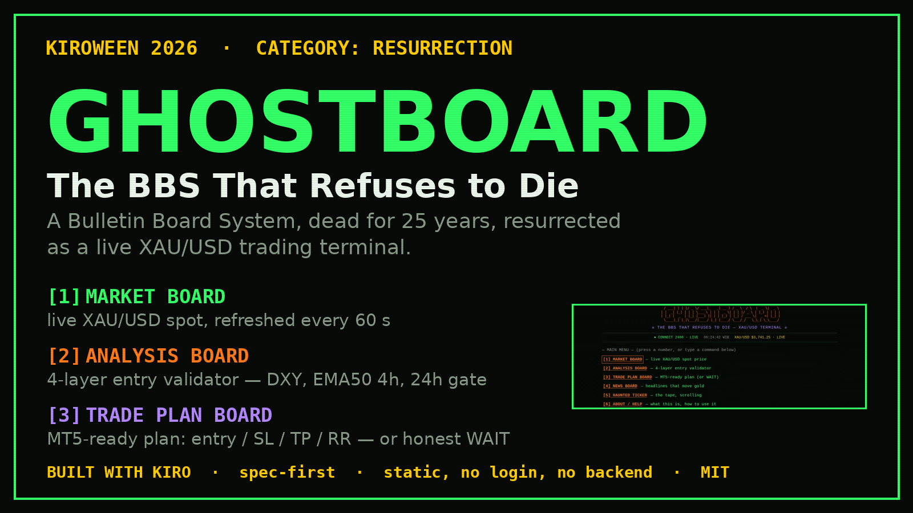
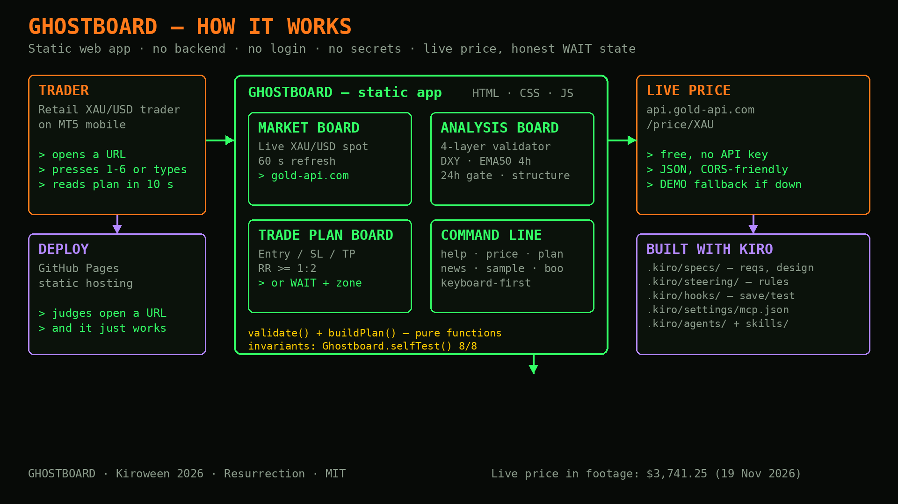

# GHOSTBOARD — The Haunted BBS for Gold Traders

**Kiroween 2026 · Category: Resurrection · Team: Mission Control (IDR + agents)**



GHOSTBOARD resurrects the **Bulletin Board System (BBS)** — the dial-up community
terminal of the 1980s–90s, dead for 25 years — as a live gold-trading terminal
for retail XAU/USD traders on MT5.

Instead of another bloated trading dashboard, GHOSTBOARD is a fast,
distraction-free, keyboard-first terminal: dial in, read the boards, get a
structured trade plan, dial out. Spooky by design (it is Kiroween, after all),
serious underneath: live spot gold price, a 4-layer entry validator, and an
MT5-ready plan (entry / SL / TP / risk) computed from the live price.

## Why a BBS? Why gold?

- **Dead tech, real problem.** BBSes died because the web got faster — but
  modern trading apps got slower, noisier, and full of ads. A BBS is the
  opposite: one screen, text-first, zero clutter, works on any phone.
- **Real audience.** Millions of retail gold traders (like IDR, who trades
  XAU/USD on MT5 from his phone) check price + plan several times a day.
  GHOSTBOARD gives them that in under 10 seconds, no login, no install.
- **Built with Kiro, spec-first.** Every feature started as a Kiro spec
  (`.kiro/specs/ghostboard/`), guided by steering docs, enforced by hooks,
  extended by MCP, and reviewed by a custom Kiro agent. See
  `SUBMISSION.md` for the full Kiro write-up.

## How it works



## Run it

No build step, no backend, no API key, no login.

```bash
# Option 1 — open directly
open ghostboard/index.html

# Option 2 — serve locally (any static server)
cd ghostboard && python3 -m http.server 8000
# → http://localhost:8000
```

Live price comes from the free, no-key endpoint `api.gold-api.com/price/XAU`.
If the network is unavailable the app falls back to clearly-labelled DEMO data
so judges can still see every board working.

## Features (MVP)

| Board | What it does |
|---|---|
| `1` Market Board | Live XAU/USD spot, 24h change, day range, trend |
| `2` Analysis Board | 4-layer entry validator (DXY, EMA50 4h, 24h move, structure) |
| `3` Trade Plan Board | MT5-ready plan: entry / SL / TP / RR, or WAIT + zone to watch |
| `4` News Board | Curated gold-moving headlines (dated, sources linked) |
| `5` Haunted Ticker | Scrolling tape: price, DXY, BTC, fear/greed |
| `6` About | What GHOSTBOARD is, how to use it, credits |

Plus a **command line** (`help`, `price`, `plan`, `boards`, `clear`, `boo` …)
and full keyboard navigation — just like a real BBS.

## Repo layout

```
ghostboard/            # the app (static HTML/CSS/JS)
.kiro/                 # Kiro usage evidence — DO NOT gitignore
  steering/            # product.md, tech.md, structure.md
  specs/ghostboard/    # requirements.md, design.md, tasks.md
  hooks/               # lint-on-save, test-on-save
  settings/mcp.json    # MCP servers (filesystem, fetch)
  agents/              # ghost-analyst custom agent
  skills/              # gold-analysis skill
  prompts/             # demo script prompt
RESEARCH.md            # rules, prizes, deadlines, cross-check
SUBMISSION.md          # Devpost submission pack (draft text, video script)
```

## Submission status (for IDR — the human who submits)

- [x] App MVP working (static, deployable to GitHub Pages)
- [x] `.kiro/` at repo root with specs, steering, hooks, MCP, agent, skill
- [x] MIT LICENSE
- [ ] Push to **public GitHub repo** (IDR's account) — NOT done by agents
- [ ] Deploy live URL (GitHub Pages) — 2 clicks after push
- [ ] Demo video < 3 min on YouTube (public) — draft v1 (2:48, `kiroween-video-draft-v1.mp4`) siap di VM, belum di-upload; upload + URL menunggu IDR
- [x] Footage F1–F9 for SBY in `footage/` (done 19 Nov, 1920×1080/30fps,
      narration slots filled, 392 words) — SBY edits final, IDR uploads
- [ ] Devpost draft + submit — IDR clicks "Enter a Submission"
- [ ] Optional bonus: Social Blitz post (`#KiroweenHackathon26` first) + blog post
- [ ] Kiro credits: request 4,000 free credits by **1 Dec 2026 12:00 PT**
      via the Credit Request Form (needs IDR's Kiro user ID / AWS account ID)

**Deadline: Sat 5 Dec 2026, 05:00 WIB** (Fri 4 Dec, 14:00 PT).
Judging 16 Dec 2026 – 29 Jan 2027 · Winners ~3 Feb 2027.

## Honest notes

- Price is live; analysis/plan logic is rule-based from the live price.
  News items are curated samples with dates — the app labels demo/sample data.
- If we win, Devpost/AWS will ask the winner for an affidavit + tax form
  (non-US residents: **W-8BEN**) within 10 business days. That is a decision
  for IDR at claim time, not now. See `RESEARCH.md §5`.
- No payment, no wallet, no KYC was used to build this. Entry is free.

## License

MIT — see `LICENSE`.
